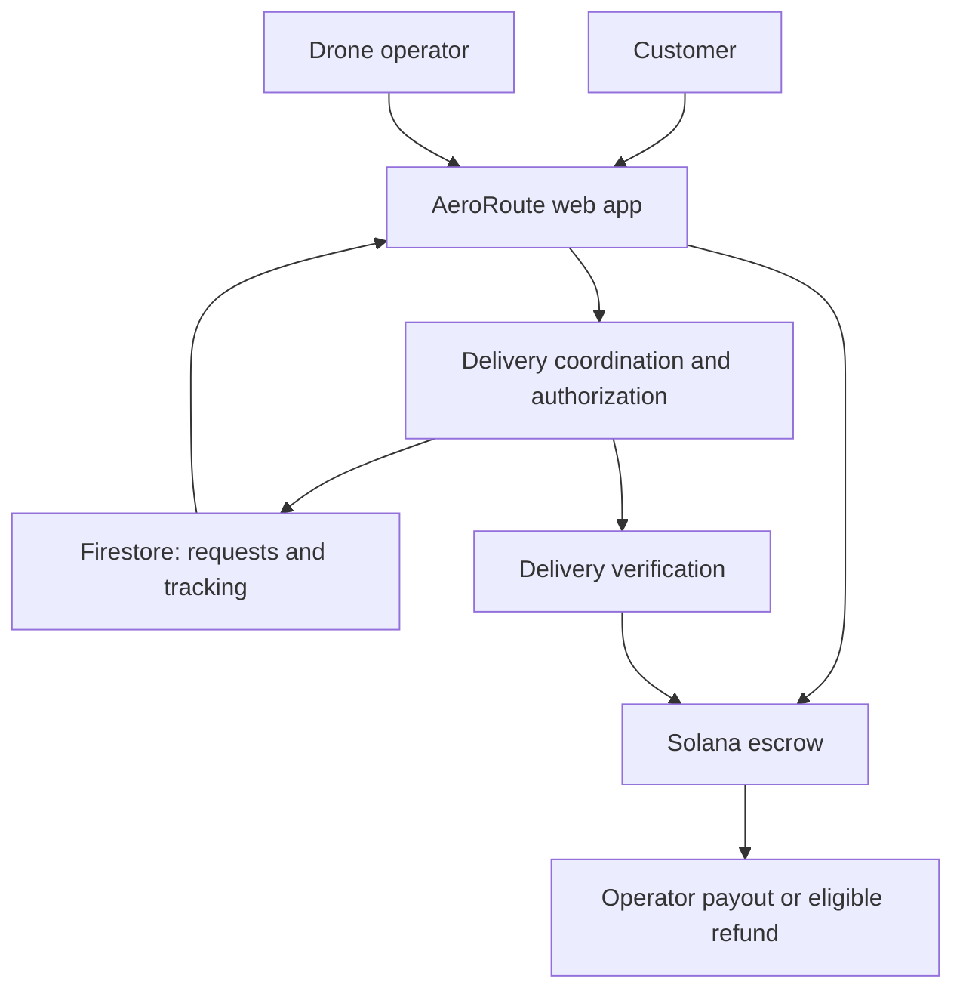

Submission to [Hackathon Name] — AeroRoute
Drone delivery. Open network. Transparent payments.
AeroRoute is a drone-delivery concept that connects people sending small parcels with independent drone operators. Our goal is to make requesting a delivery as straightforward as booking a ride, with real-time tracking and Solana-based escrow settlement.
Submission by:
- Roman Jaishibekov — Instagram
- Batumukhammed Beksultan — X · GitHub
- Kanat Aldabek — Instagram · Behance
- Galymbek Muratbay — Behance · Portfolio
- Magzhan Skakov — GitHub · X
Resources
- Presentation: [Add AeroRoute presentation URL]
- Platform demo: [Add AeroRoute demo URL]
- Landing page: [Add AeroRoute landing page URL]
- Demo video: [Add AeroRoute video URL]
- Repository: [Add AeroRoute repository URL]
Problem and solution
Urgent deliveries of documents, medicines and lightweight parcels can be delayed by road traffic. Independent drone operators also need a shared way to find delivery requests, coordinate handoffs and receive payment.
Our Solution
AeroRoute proposes an open delivery marketplace connecting customers directly with drone operators.
1. Request: The customer selects pickup and destination points and enters parcel details.
2. Fund: The customer approves a payment held in a Solana escrow contract.
3. Deliver: An available operator accepts the job, while delivery updates reach the customer through Cloud Firestore.
4. Confirm: Delivery is verified before the escrow releases payment to the operator.
Customers would manage their deliveries; operators would manage drones, accepted requests and earnings. The concept brings physical delivery services into a decentralized physical infrastructure network (DePIN).
Summary of Submission Features
Current interactive prototype
- Responsive AeroRoute landing page with customer and operator information.
- Route calculator interface with pickup and destination fields.
- Parcel categories with illustrative price and delivery-time estimates.
- Out-of-coverage state and ground-delivery messaging.
- Visual flight-route preview with sample telemetry.
- Delivery-process explanation and frequently asked questions.
Planned product capabilities
- Customer/operator login, profiles and separate dashboards.
- Delivery creation and operator acceptance.
- Firestore-backed real-time status updates.
- Solana wallet connection and escrow settlement.
- Verified handoff and cancellation/refund handling.
The current submission is a frontend prototype. Flight telemetry and estimates are illustrative; live drone operations, AeroRoute authentication, Firestore tracking and escrow payments are planned integrations.
Tech Stack
- Current frontend: React, TypeScript, Vite.
- Styling: Tailwind-style utilities, CSS.
- Demo state: React component state.
- Blockchain dependencies: Solana Web3.js, wallet-adapter, Metaplex.
- Target application architecture: Next.js, Cloud Firestore and a Solana escrow program.
Architecture
Target delivery architecture; backend and settlement components are planned.

Quick Start Guide
Open a terminal in the frontend project directory:
npm install
npm run dev
Open the local URL printed by Vite.
To check and build the prototype:
npm run lint
npm run build
npm run preview
The current frontend demo requires no external API credentials. Real delivery, tracking and payment services require the planned integrations.